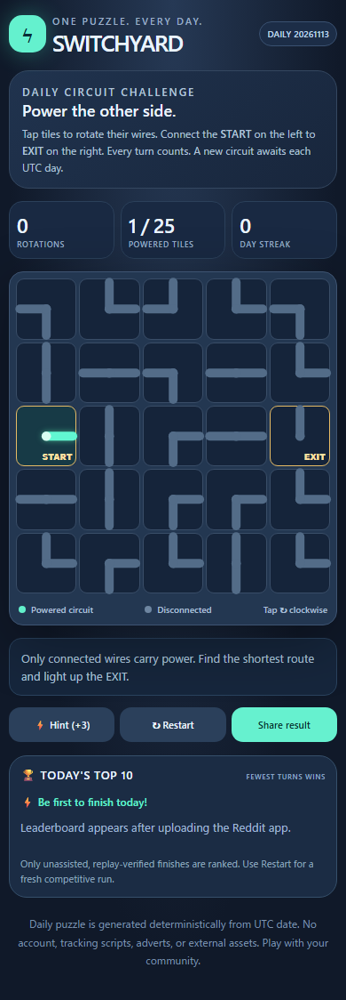
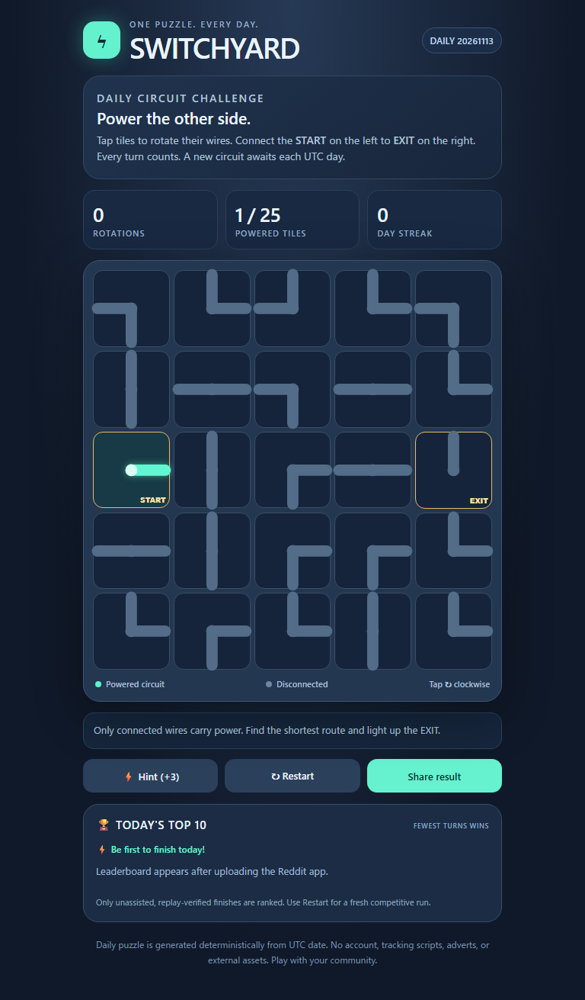

# SWITCHYARD — Daily Circuit Puzzle for Reddit

**Status (2026-11-14 JST):** Official entry **submitted** to the 2026 Reddit Game of the Day Hackathon: https://devpost.com/software/switchyard-daily-circuit-puzzle . Devvit app v0.0.1 was uploaded and Reddit playtest was successful. The test subreddit remains private pending Reddit's public-access approval; judge access is not yet confirmed. No prize or payment is guaranteed.

SWITCHYARD is an original five-by-five daily circuit puzzle. Rotate each tile until electricity flows from START on the left to EXIT on the right. Everybody in the same UTC day plays the same solvable challenge. The game is free, mobile friendly, keyboard-accessible, and has a Discord-style shareable result.

## How to play

1. Open the game post on Reddit and tap **PLAY TODAY'S CIRCUIT**.
2. Tap a tile to rotate its wires 90 degrees clockwise.
3. Power propagates only when neighboring tile ports face each other. Powered segments glow mint.
4. Connect the left START node to the right EXIT node in as few turns as possible.
5. Play daily for a streak, copy a score card, or compare with the subreddit leaderboard.
6. **Hint (+3)** reveals a path alignment and disqualifies that attempt from the verified leaderboard; **Restart** resets the same daily puzzle for a fresh ranked attempt.

## Technical design

- Reddit's official **Devvit Web** React template (React inline splash and an expanded, responsive HTML game).
- Deterministic daily maze/graph generator, seeded via FNV-1a and a fixed linear congruential PRNG, with no server dependency for casual play.
- The route is guaranteed solvable; crossings and decoy wires create several meaningful alternatives.
- Daily puzzle and streak state persisted locally in `localStorage`.
- Server route **POST /api/score** replays every individual tile rotation using a separate, deterministic TypeScript rules engine. It rejects invalid indices, impossible solutions, post-win extra moves, mismatched UTC day, and paths longer than 250 moves. No score supplied by the client is trusted.
- Server route **GET /api/leaderboard** lists the 10 lowest verified rotation counts for the subreddit and current UTC date. Records use Devvit Redis sorted sets, and only the player's authenticated Reddit username is stored in the leaderboard.
- No third-party advertising, telemetry, external client assets, access tokens, or personally identifiable data beyond the Reddit username used for rankings.

## Project layout

- `src/client/splash.tsx`: lightweight Reddit inline post; expands to full game
- `src/client/game.html`, `switchyard.css`, `switchyard.js`: expanded playable game
- `src/shared/engine.ts`: shared deterministic rules / server replay verifier
- `src/server/routes/api.ts`: leaderboard retrieval and score validation
- `tests/switchyard-test.cjs`: DOM gameplay smoke tests
- `tests/replay-test.mjs`: 30 seeded UTC dates, parity with client JS, actual browser-click replay, forgery rejection
- `switchyard.html`: standalone demo; not the contest submission

## Setup and verification

Requires Node.js 24.18+ and a Reddit Developer Platform account.

```bash
npm install
npm run build
npm run test:types
npm run test:regression
npm run lint
node tests/switchyard-test.cjs
node --experimental-strip-types --no-warnings=ExperimentalWarning tests/replay-test.mjs
```

The app has been uploaded privately as **switchyard-rome** and installed on **r/switchyard_rome_dev**. Local code still uses the following authenticated Devvit developer workflow:

```bash
npm run login
npm run dev
# Create the daily game via the moderator menu on your dedicated playtest subreddit.
# When ready: npm run deploy
```

The Reddit Game of the Day Hackathon **does not require publishing** the app publicly before the deadline. The private Devvit app and actual Reddit playtest post are available at https://developers.reddit.com/apps/switchyard-rome and https://www.reddit.com/r/switchyard_rome_dev/comments/1xv4zw2/switchyard_daily_circuit_puzzle/ . The test subreddit was automatically created as **private**; a request to make it public for judge access is pending Reddit review. The entry **was submitted to Devpost on 2026-11-14 JST**: https://devpost.com/software/switchyard-daily-circuit-puzzle . Public subreddit approval and additional-player leaderboard testing remain outstanding. See DEVPOST_ENTRY.md for live status.

## Contest and copyright note

Prepared for the [Reddit Game of the Day Hackathon](https://redditgameofday2026.devpost.com/), deadline 2026-12-08 18:00 PST. AI assistance was used to develop and test the code; the app is an original game, not a copy of another game's graphics or a copyrighted brand. Winning is never guaranteed. A person who controls the Reddit/Devpost accounts must explicitly accept provider terms and handle any required legal, tax or payment verification.

© 2026 rometet. Original game logic. Upstream Devvit template licensing retained in LICENSE.

## Visual preview





Competition form content and completion checklist: [DEVPOST_ENTRY.md](DEVPOST_ENTRY.md).

## Regression guarantees

The deterministic generator has been tested across 1,095 consecutive UTC dates starting November 14, 2026. No board starts solved, and all intended paths remain reachable. The replay suite also checks browser/server parity on July 28, 2029 (a previously identified edge-case seed). The score-retry test verifies that a failed network submission can be retried after reloading and is marked complete only after server confirmation.